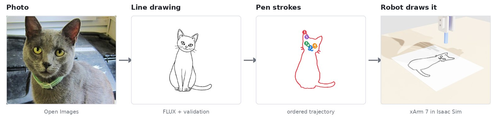
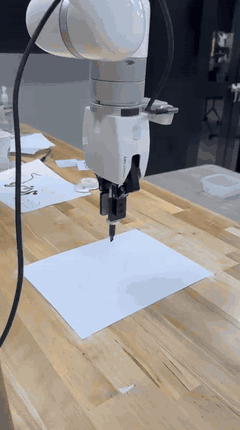
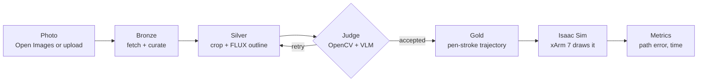
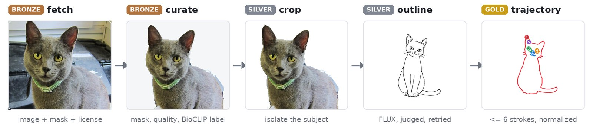
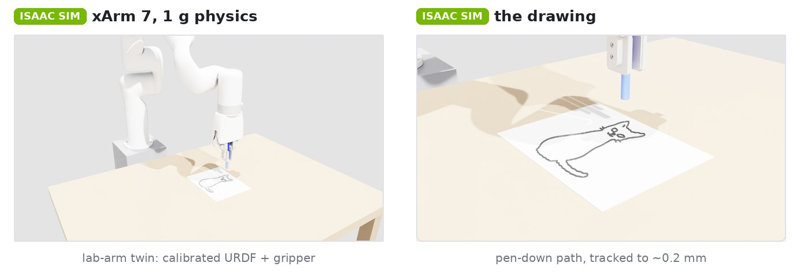
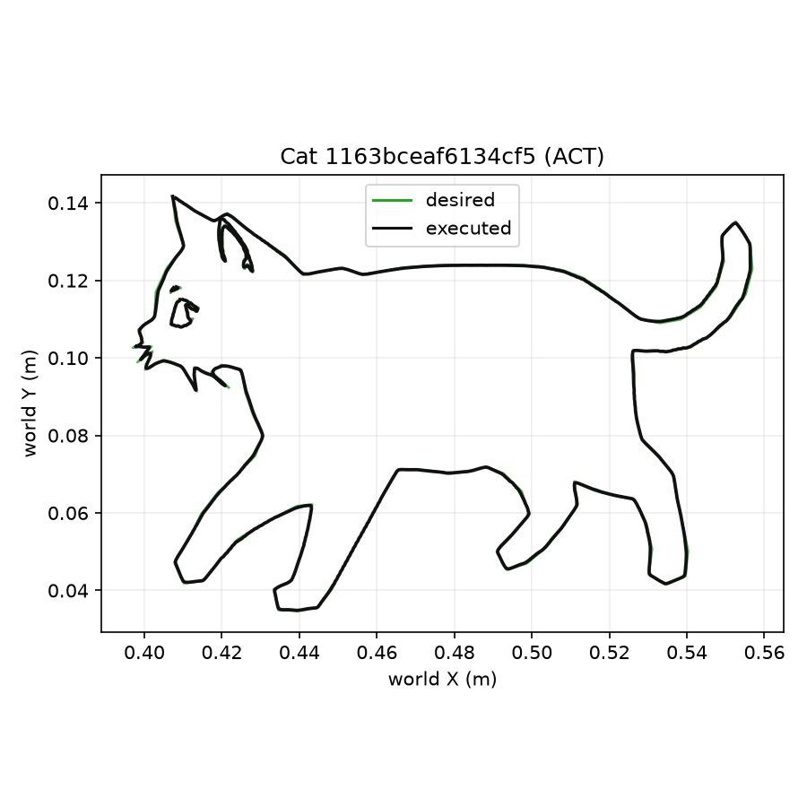
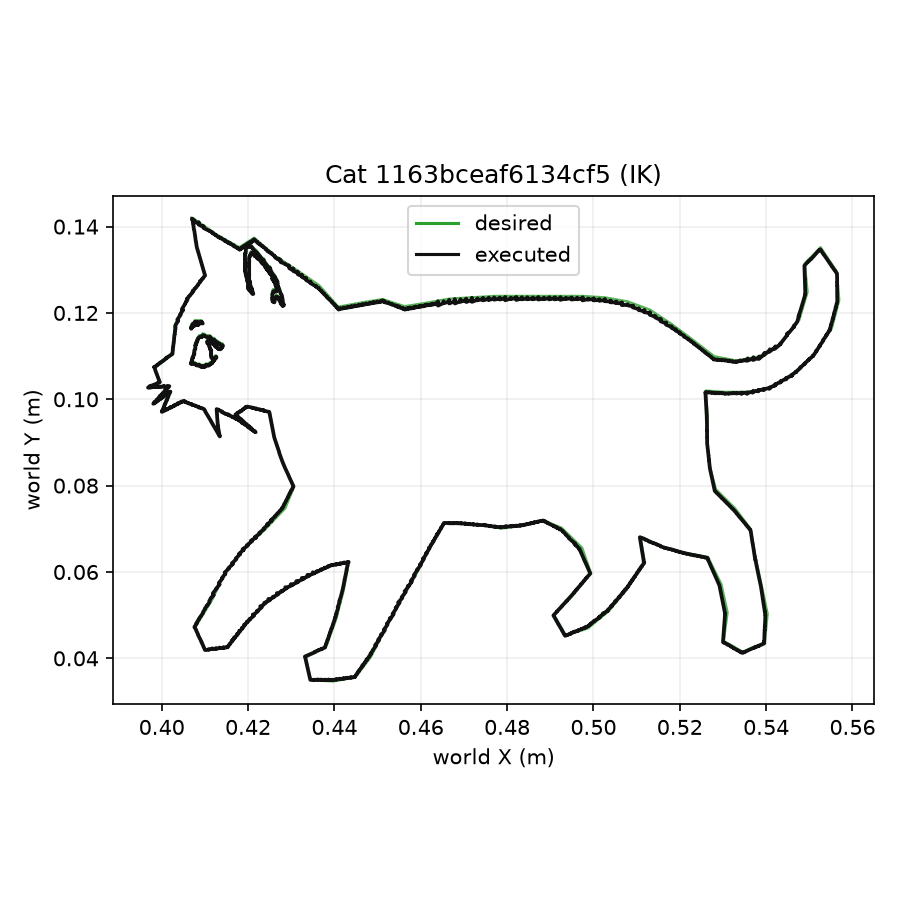
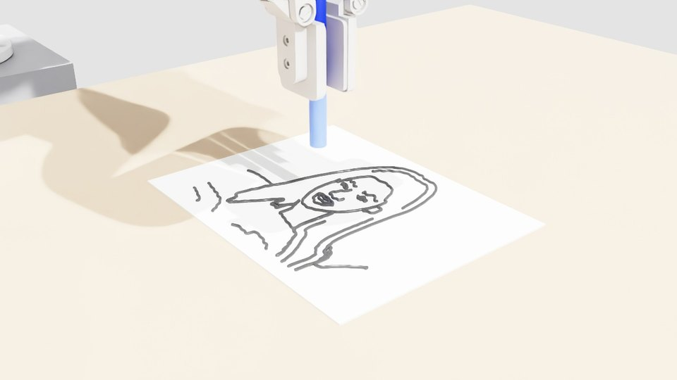
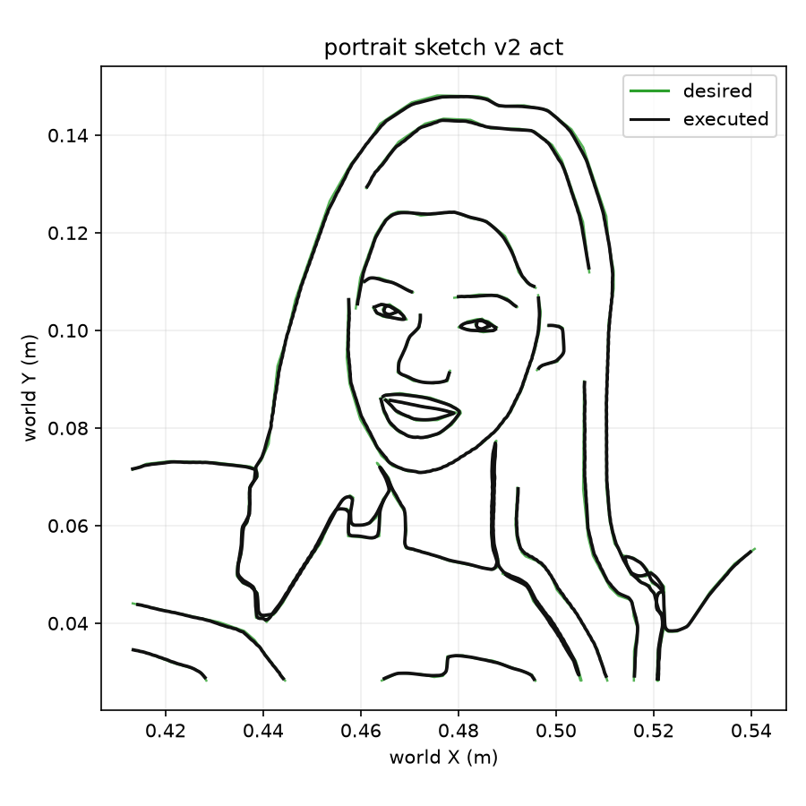
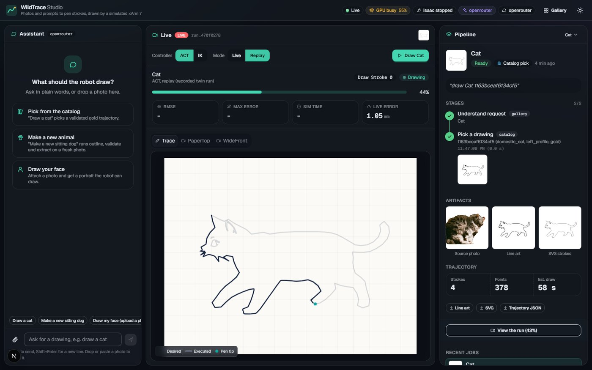

# WildTrace

**Turn animal photos into line drawings, and have a robot arm draw them.**

WildTrace takes real photos (Open Images), turns each one into a clean outline and a set of pen strokes,
and then a simulated UFACTORY xArm 7 draws them on paper in NVIDIA Isaac Sim. Learned controllers (ACT,
SmolVLA) are compared against classic inverse kinematics on the same drawings.



## From simulation to the real arm

<table>
  <tr>
    <td width="260"><a href="docs/readme/bird_live_edit.mp4"></a></td>
    <td>
      The same pipeline, on a real UFACTORY xArm 7 in the lab: a WildTrace bird trajectory, drawn with a pen
      on paper (shown at 12x speed).
      <br><br>
      The lab-arm twin in Isaac Sim is built from this arm's calibrated model and its measured paper
      placement, so simulation runs match the real setup.
      <br><br>
      <a href="docs/readme/bird_live_edit.mp4"><b>Watch the 40-second video (with sound)</b></a>
    </td>
  </tr>
</table>

## How it works



The project has two halves. A **data pipeline** turns photos into robot-ready trajectories. A **robot
simulation** draws those trajectories and measures how well it did.

## 1. Data pipeline: photo to pen strokes



A local-first **medallion pipeline**: each layer is a standalone script with versioned, append-only
manifests, so reruns only redo what changed.

| Layer | What happens | Key tools |
|---|---|---|
| **Bronze** | Download images, masks and licenses; drop duplicates, low quality and bad angles; label the animal | Open Images, BioCLIP |
| **Silver** | Normalize, cut the subject out, draw a clean outline, check it, retry if it fails | FLUX, OpenCV, VLM judge, LangGraph |
| **Gold** | Keep the best drawing per pose; turn it into at most 6 ordered pen strokes on a normalized canvas | SVG, NDJSON export |

Output so far: **2,874 validated trajectories** across six animals, plus a **48-drawing gold test set** that no policy trains on.

## 2. Robot: drawing in Isaac Sim



The xArm 7 runs at Earth gravity with a pen in its gripper. The **lab-arm twin** scene uses the calibrated
arm model and the measured paper placement from the real lab setup. Each drawing is approach → lower → draw
→ lift, stroke by stroke. Every run logs the planned path against the path the pen actually took.

The same drawings are drawn by different **controllers**:

| Controller | Idea |
|---|---|
| **Lula IK** | Classic inverse kinematics: solve joint angles for each waypoint, wait until reached |
| **ACT** | Learned policy (Action Chunking Transformer) that looks at the upcoming path and predicts the next joint moves |
| **SmolVLA** | Pretrained vision-language-action model, fine-tuned on the same data (training in progress) |
| **PPO** | Reinforcement-learning baseline on the same task |

### Results (gold test set, lab-arm twin, 1 g)

| Controller | Drawings finished | Path error (RMSE) | Smoothness (jerk) |
|---|---|---|---|
| Lula IK | 44 / 48 | 0.283 mm | 752 |
| **ACT** | **48 / 48** | **0.195 mm** | **390** |

ACT finishes every drawing, follows the path more closely than IK on all 44 drawings both finished, and moves
about twice as smoothly.

<table>
  <tr>
    <td></td>
    <td></td>
  </tr>
  <tr>
    <td align="center">ACT: 0.21 mm, 56 s</td>
    <td align="center">IK: 0.31 mm, 106 s</td>
  </tr>
</table>

## Faces too

Upload a photo, pick a face, get a portrait the robot can draw. Faces are traced from MediaPipe's face
landmarks and hair and body segmentation, all on the CPU, in a pen-sketch style.

<table>
  <tr>
    <td></td>
    <td></td>
  </tr>
</table>

## WildTrace Studio

A chat-and-upload web app for the whole flow. Ask "draw a cat", "make a new sitting dog", or drop in a photo.
Then watch the stages, the live pen trace and the camera feeds.



## Key terms

| Term | In one line |
|---|---|
| **FLUX** | Image generation model that redraws the photo's subject as a clean outline |
| **VLM judge** | A vision-language model that checks the outline really is the right animal, with OpenCV checks first |
| **LangGraph** | Runs the outline → judge → retry loop |
| **BioCLIP** | Biology-tuned CLIP model that labels the animal's species and type |
| **Lula IK** | NVIDIA's inverse-kinematics solver: target pen position → joint angles |
| **ACT** | Action Chunking Transformer: imitation-learning policy that predicts short chunks of future actions |
| **SmolVLA** | Small (450M) vision-language-action model from Hugging Face, pretrained on robot data |
| **LeRobot** | Hugging Face library used for the ACT and SmolVLA datasets and training |
| **Isaac Sim** | NVIDIA's physics and rendering simulator, where the robot draws |
| **RMSE** | Average distance between the planned and the drawn path |

## Quick start

```bash
# Python 3.12, uv, a CUDA GPU for FLUX
uv sync --extra dev
cp .env.example .env          # model hosts, optional API keys
uv run pytest                 # tests

# Pipeline, stage by stage (each accepts --category Cat etc.)
uv run python scripts/fetch_openimages.py
uv run python scripts/curate_bronze.py
uv run python scripts/normalize_to_silver.py
uv run python scripts/enrich_and_crop_subjects.py
uv run python scripts/generate_line_diagrams.py
uv run python scripts/validate_and_retry_diagrams.py
uv run python scripts/select_final_by_angle.py
uv run python scripts/extract_trajectories.py
uv run python scripts/export_gold_ndjson.py

# Studio app
uv sync --extra dev --extra app
uv run --extra app uvicorn wildtrace_app.main:app --app-dir app/backend --port 8000
cd app/frontend && npm install && npm run dev    # http://localhost:3000
```

The robot side needs Isaac Sim 6.0.1. See [isaac-sim/README.md](isaac-sim/README.md).

## Repository

```
wildtrace/     pipeline package: stages, outline models, validators, face line art
scripts/       one script per pipeline stage, benchmarks
configs/       datasets, models, quality gates, export limits
isaac-sim/     robot scenes, controllers, ACT / SmolVLA training, results
app/           WildTrace Studio (FastAPI + Next.js)
docs/          plans, benchmarks, architecture diagrams
```

More detail: [pipeline plan](docs/Plan.md) · [architecture](docs/diagrams/WildTracePipelineArchitecture.svg) ·
[Isaac Sim](isaac-sim/README.md) · [Studio](app/README.md) · [ACT results](isaac-sim/results/act_eval/act_real_v2_stiff_results.md)

<sub>Cat photo: "I'll be good!  Promise!" by jeffreyw (<a href="https://www.flickr.com/photos/jeffreyww/7591928192">Flickr</a>), <a href="https://creativecommons.org/licenses/by/2.0/">CC BY 2.0</a>, via Open Images.</sub>
